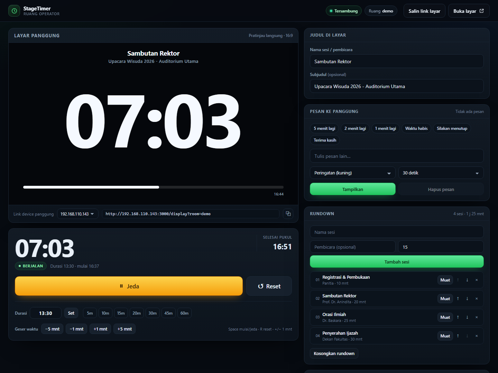
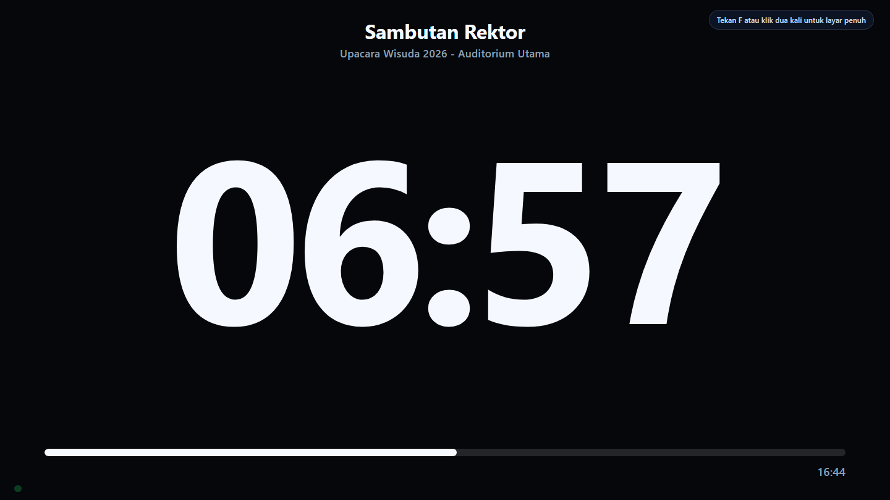

# StageTimer — timer panggung

Aplikasi timer untuk acara/panggung, mirip stagetimer.io. Repo GitHub:
**[tenzou-dev/TimeKeeper](https://github.com/tenzou-dev/TimeKeeper)**.
Ada dua cara pakai:

| Mode | Cara akses | Cocok untuk |
| --- | --- | --- |
| **Online (Cloudflare)** | `https://stage-timer.<akun>.workers.dev` | Tanpa menyalakan server; operator login dari mana saja |
| **Lokal (LAN)** | `http://localhost:3000` | Cadangan offline saat internet venue tidak stabil |

Keduanya memakai tampilan yang sama:

- **Dashboard operator** — atur durasi, mulai/jeda, tambah/kurangi waktu, kirim pesan,
  kelola rundown, dan atur tema layar.
- **Layar panggung** — hanya menampilkan timer raksasa, judul sesi, pesan, dan progress bar.
- **Sinkron realtime** — semua device yang membuka link layar dengan ruang yang sama
  langsung ikut berubah. Waktu dihitung dari jam server, jadi tidak melenceng antar device.
- **Login operator (mode online)** — dashboard dilindungi login. Bisa memakai email +
  password (akun admin) atau **GitHub OAuth**. Layar panggung tetap bisa dibuka tanpa login.
- **Banyak akun lewat GitHub** — siapa pun yang punya akun GitHub bisa masuk; login pertama
  otomatis membuat akun. Setiap akun mendapat **ruang timer sendiri**, jadi pengguna lain
  tidak bisa mengubah timer acara orang lain.

### Tangkapan layar

| Dashboard operator | Layar panggung |
| --- | --- |
| [](docs/screenshots/dashboard.png) | [](docs/screenshots/stage-display.png) |

---

## Link penting

- Aplikasi online: <https://stage-timer.tenzou-dev.workers.dev>
- Repo GitHub: <https://github.com/tenzou-dev/TimeKeeper>
- Link layar publik (contoh): <https://stage-timer.tenzou-dev.workers.dev/display?room=utama>

---

## Mode online: deploy ke Cloudflare

Mode ini memakai **Cloudflare Workers + Durable Objects**. Tidak perlu VPS dan tidak perlu
menyalakan laptop operator sebagai server.

### 1. Prasyarat

- Akun Cloudflare (gratis). Durable Objects dengan penyimpanan SQLite tersedia di free plan;
  jika akunmu belum mendukung, paket Workers Paid bisa dipakai.
- **Node.js 18+** dan npm.
- Terminal di folder `stage-timer`.

### 2. Install dependency

```powershell
npm install
```

### 3. Login ke Cloudflare

```powershell
npx wrangler login
```

Browser akan terbuka untuk meminta izin akses.

### 4. Deploy pertama

```powershell
npm run deploy
```

Wrangler akan menampilkan URL, misalnya:

```text
https://stage-timer.nama-akun.workers.dev
```

Pada deploy pertama, dashboard belum bisa dipakai karena akun operator belum diatur.
Lanjut ke langkah berikutnya.

### 5. Set akun operator admin (fallback)

Akun ini berguna sebagai cadangan kalau login GitHub belum diatur, dan bisa mengatur
**semua ruang**. Kalau kamu hanya mau memakai GitHub, langkah ini boleh dilewati — tapi
sangat disarankan tetap diisi.

Jalankan tiga perintah ini satu per satu. Nilai yang dimasukkan **tidak** tersimpan di file
dan **tidak** ikut ter-upload ke git.

```powershell
npx wrangler secret put ADMIN_EMAIL
npx wrangler secret put ADMIN_PASSWORD
npx wrangler secret put SESSION_SECRET
```

- `ADMIN_EMAIL` — email untuk login, contoh `operator@example.com` (huruf besar/kecil tidak masalah).
- `ADMIN_PASSWORD` — password yang kuat, minimal 12 karakter.
- `SESSION_SECRET` — teks acak panjang. Buat dengan:

  ```powershell
  node -e "console.log(crypto.randomUUID() + crypto.randomUUID())"
  ```

  `SESSION_SECRET` menandatangani cookie login. Kalau diganti, semua sesi lama otomatis
  logout. Kalau dikosongkan, aplikasi memakai turunan dari `ADMIN_PASSWORD`.

Secret langsung aktif setelah perintah selesai; tidak perlu deploy ulang.

### 6. Login GitHub (opsional, untuk banyak akun)

Kalau link akan dibagikan dan orang lain perlu akun sendiri, aktifkan GitHub OAuth.

1. Buka GitHub → **Settings → Developer settings → OAuth Apps → New OAuth App**.
2. Isi:
   - **Application name** — mis. `StageTimer`
   - **Homepage URL** — `https://stage-timer.<akun>.workers.dev`
   - **Authorization callback URL** — `https://stage-timer.<akun>.workers.dev/api/auth/github/callback`
3. Salin **Client ID**, lalu buat **Client secret**.
4. Simpan sebagai secrets Worker:

   ```powershell
   npx wrangler secret put GITHUB_CLIENT_ID
   npx wrangler secret put GITHUB_CLIENT_SECRET
   ```

5. Buka halaman login — tombol **Masuk dengan GitHub** akan muncul.

Catatan:

- Login pertama otomatis membuat akun; tidak perlu daftar terpisah.
- Setiap akun GitHub mendapat ruang sendiri dengan nama `u<nomor-id-github>`. Dashboard
  otomatis diarahkan ke ruang itu, dan akun tersebut **tidak bisa** mengubah ruang lain
  (server menolak dengan `403`).
- Link layar panggung untuk akun tersebut bisa dilihat di footer dashboard, bentuknya
  `https://.../display?room=u12345678`. Link ini publik dan aman dibagikan ke tim panggung.
- Akun admin (email + password) tetap bisa mengatur semua ruang.
- Satu OAuth App hanya punya satu callback URL. Untuk testing OAuth di komputer sendiri,
  buat OAuth App terpisah dengan callback
  `http://localhost:8787/api/auth/github/callback`, lalu isi kredensialnya di `.dev.vars`.
- `GITHUB_CLIENT_SECRET` hanya disimpan sebagai secret Worker; jangan pernah commit ke git.

### 7. Buka aplikasi

Buka URL Worker → kamu akan diarahkan ke **halaman login** → masuk dengan GitHub, atau
dengan `ADMIN_EMAIL` dan `ADMIN_PASSWORD`.

Link layar panggung (publik, tanpa login):

```text
https://stage-timer.nama-akun.workers.dev/display?room=utama
```

Buka link itu di laptop/tablet yang terhubung ke proyektor, lalu tekan **F** atau klik dua
kali untuk fullscreen.

### 8. Ganti nama / domain (opsional)

- Nama Worker ada di `wrangler.jsonc` (`"name": "stage-timer"`). Ganti kalau URL
  `*.workers.dev` yang diinginkan sudah dipakai.
- Custom domain bisa ditambahkan lewat dashboard Cloudflare → Workers & Pages → pilih
  Worker → **Settings → Domains & Routes**.
- Setelah mengganti nama/domain, jalankan `npm run deploy` lagi bila perlu.

### 9. Tes online di komputer sendiri

Sebelum deploy, kamu bisa menjalankan versi Cloudflare secara lokal:

```powershell
Copy-Item .dev.vars.example .dev.vars
npm run dev
```

Buka `http://localhost:8787`. Isi `.dev.vars` dengan akun uji, misalnya:

```dotenv
ADMIN_EMAIL=operator@example.com
ADMIN_PASSWORD=password-uji-yang-kuat
SESSION_SECRET=teks-acak-panjang
```

`.dev.vars` hanya untuk testing lokal dan sudah masuk `.gitignore`.

### Mengubah akun / password

```powershell
npx wrangler secret put ADMIN_PASSWORD
```

Setelah password diganti, login ulang. Kalau ingin memaksa semua device logout, ganti juga
`SESSION_SECRET`. Tidak ada fitur “lupa password” — pemulihan dilakukan lewat Wrangler.

Untuk login GitHub, ganti `GITHUB_CLIENT_ID` / `GITHUB_CLIENT_SECRET` lewat `wrangler secret
put`. Tidak ada database akun terpisah: identitas diambil langsung dari GitHub saat login.

---

## Mode lokal: cadangan offline (LAN)

Cocok saat venue tidak punya internet. Tidak perlu akun dan tidak perlu install dependency.

1. Pastikan **Node.js 18+** terpasang (`node -v`).
2. Dobel-klik **`start.bat`** (Windows). Jendela hitam akan terbuka dan menampilkan alamat.
3. Buka dashboard di laptop operator: <http://localhost:3000>
4. Di laptop/tablet yang terhubung ke proyektor, buka link layar yang tertera di dashboard,
   misalnya `http://192.168.1.29:3000/display?room=utama`.
5. Di layar panggung: tekan **F** atau klik dua kali untuk fullscreen.

> Jangan tutup jendela hitam selama acara berjalan — itu adalah server-nya.

Kalau port 3000 sudah dipakai, jalankan `start.bat 8080` lalu buka
`http://localhost:8080`.

Mode lokal **tidak memakai login** karena dirancang untuk jaringan LAN tepercaya. Jangan
buka port-nya ke internet.

---

## Alur singkat saat acara

1. Login ke dashboard (mode online) atau buka `http://localhost:3000` (mode lokal).
2. Isi **Nama sesi / pembicara** dan **durasi**, lalu klik **Set**.
3. Klik **Mulai** (atau tekan **Space**).
4. Saat pembicara hampir habis:
   - Timer berubah **kuning** saat sisa waktu ≤ 5 menit.
   - Berubah **oranye** saat ≤ 1 menit.
   - Setelah 0, timer berubah **merah**, berkedip, menampilkan **WAKTU HABIS**, dan
     mulai menghitung ke atas (`+00:12`) supaya operator tahu sudah lewat berapa lama.
5. Butuh tambahan waktu? Klik **+1 mnt** / **+5 mnt**. Butuh mempercepat? **−1 mnt** / **−5 mnt**.
6. Kirim pesan ke panggung lewat tombol cepat (mis. “5 menit lagi”) atau tulis pesan sendiri.
7. Sesi berikutnya: tambahkan di **Rundown**, lalu klik **Muat** untuk langsung mengisi
   judul + durasi sesi tersebut.

### Tombol & shortcut

| Aksi | Cara |
| --- | --- |
| Mulai / jeda | `Space` atau tombol besar |
| Reset timer | `R` (konfirmasi bila sedang berjalan) |
| Tambah / kurangi 1 menit | `+` / `−` |
| Layar penuh di layar panggung | `F` atau klik dua kali |
| Keluar layar penuh | `Esc` |
| Keluar dari akun (online) | Tombol **Keluar** di kanan atas |

---

## Fitur

- Countdown besar yang mudah dibaca dari jauh, dengan angka tabular (tidak “goyang”).
- Warna peringatan kuning/oranye/merah + kedip saat waktu habis.
- Hitung ke atas (overtime) setelah 0.
- Pesan operator: teks + warna (info/peringatan/bahaya/selesai) + durasi tampil.
- Rundown: tambah, urutkan, muat sesi, total durasi; sesi berikutnya tampil di layar.
- Pratinjau layar panggung langsung di dashboard.
- Tema **gelap** (ruangan redup) dan **terang** (panggung/proyektor terang).
- Atur ambang kuning & merah sendiri.
- Progress bar, jam dinding, subjudul, indikator koneksi — semuanya bisa dimatikan.
- Beberapa **ruang** (`?room=nama`) untuk beberapa panggung/seksi sekaligus.
- State tersimpan otomatis di server; refresh browser tidak menghilangkan timer.
- Timer tetap jalan walau device operator sempat terputus, karena waktu dihitung dari server.
- Login operator dengan cookie sesi 24 jam (mode online), lewat GitHub atau email/password.
- Setiap akun GitHub otomatis mendapat ruang timer terpisah; tidak bisa mengontrol ruang
  akun lain. Akun admin tetap bisa mengatur semua ruang.

---

## Checklist sebelum acara

Lakukan 10–15 menit sebelum mulai:

- [ ] **Mode online:** buka URL Worker, pastikan login berhasil dan status **Tersambung**.
      **Mode lokal:** pastikan server berjalan dan dashboard terbuka.
- [ ] Buka link layar di device panggung — pastikan timer ikut berubah saat dashboard menekan Mulai.
- [ ] **Mode lokal:** jika Windows menanyakan firewall, pilih **Allow access** untuk
      **Private network**.
- [ ] Layar panggung sudah **fullscreen** dan skala browser 100%.
- [ ] Matikan screen saver / sleep di kedua device.
- [ ] Matikan notifikasi (Windows: Focus assist; macOS: Do Not Disturb; HP: Do Not Disturb).
- [ ] Laptop operator tetap dicas.
- [ ] Siapkan cadangan: **mode lokal** dengan hotspot HP, atau dashboard dibuka dari HP.
- [ ] Catat `ADMIN_EMAIL` / `ADMIN_PASSWORD` di tempat aman (jangan di chat publik).

---

## Kalau device panggung tidak bisa membuka link

### Mode online

1. Pastikan URL Worker bisa dibuka di HP/laptop lain yang punya internet.
2. Pastikan path layar benar: `/display?room=utama` (bukan `/`).
3. Kalau memakai custom domain, pastikan DNS sudah aktif (status **Active** di Cloudflare).
4. Cek **Workers & Pages → stage-timer → Logs** di dashboard Cloudflare bila muncul error.
5. Coba `https://<domain>/api/config` — harus mengembalikan JSON
   `{"transport":"ws","online":true,...}`.

### Mode lokal

1. **Pastikan satu jaringan.** Cek IP laptop operator dengan `ipconfig` (IPv4 Address).
   Dashboard menampilkan link dengan IP LAN; kalau laptop punya beberapa adapter
   (WiFi + kabel/VPN), pilih IP yang benar dari dropdown di samping link.
2. **Firewall Windows.** Izinkan Node.js pada jaringan Private, atau buka PowerShell
   sebagai Administrator:

   ```powershell
   New-NetFirewallRule -DisplayName "StageTimer" -Direction Inbound -LocalPort 3000 -Protocol TCP -Action Allow -Profile Private
   ```

3. **WiFi tamu / AP isolation.** Banyak WiFi venue memisahkan antar device sehingga
   tidak bisa saling akses. Solusi: gunakan router sendiri, hotspot dari laptop/HP,
   atau colok kabel LAN.
4. **Tes dari device:** buka `http://IP-LAPTOP:3000/healthz` — harus muncul `ok`.

> Server lokal mendengarkan di semua network interface (0.0.0.0), jadi tidak perlu setting
> tambahan selain firewall.

---

## Catatan teknis

### Online (Cloudflare)

- Frontend dilayani sebagai **Workers Assets** dari folder `public/`.
- Setiap ruang (`?room=...`) adalah satu **Durable Object** bernama `Room` yang menyimpan
  state di storage SQLite dan menyiarkan perubahan lewat **WebSocket**.
- Dashboard memakai cookie `st_session` yang ditandatangani **HMAC-SHA256**; cookie bersifat
  `HttpOnly`, `SameSite=Lax`, dan `Secure` saat HTTPS. Masa berlaku 24 jam.
- `/api/action` membutuhkan sesi login dan memeriksa origin. Sesi GitHub hanya boleh
  mengubah ruangnya sendiri (`u<nomor-id-github>`); sesi admin boleh semua ruang.
  `/api/ws` dan `/api/state` bersifat publik agar layar panggung bisa dibuka tanpa akun,
  tetapi WebSocket hanya menerima ping/sync — bukan perintah yang mengubah timer.
- State timer tetap tersimpan saat tidak ada device yang terhubung. Pesan dengan batas waktu
  dihapus otomatis memakai alarm Durable Object.
- Login GitHub memakai OAuth App (`scope: read:user`) dengan state cookie anti-CSRF. Login
  pertama otomatis membuat akun; tidak ada tabel user terpisah. Login email + password tetap
  tersedia sebagai akun admin/cadangan.
- Tidak ada rate limit login bawaan. Jika URL dipublikasikan luas, aktifkan
  **Cloudflare WAF / Rate limiting** untuk `/api/login` dan `/api/auth/github/callback`.

### Lokal (Node.js)

- Tanpa dependency eksternal: cukup `node server.js`. Data disimpan di `data/rooms.json`
  (dibuat otomatis).
- Sinkronisasi memakai **SSE** (`/api/stream`), bukan WebSocket. Frontend memilih transport
  otomatis dari `/api/config`.
- Waktu acuan adalah `Date.now()` di server. Client hanya menghitung selisih, sehingga
  jam yang berbeda antar device tidak memengaruhi timer.
- Layar panggung akan tetap menampilkan hitungan meskipun koneksi putus; setelah tersambung
  lagi, state langsung disamakan dengan server. Indikator koneksi kecil di pojok kiri bawah
  berubah kuning saat terputus (bisa disembunyikan di pengaturan).
- **Wake lock** (menahan layar tetap menyala) hanya tersedia di HTTPS atau localhost.
  Saat diakses lewat IP LAN (HTTP), atur sendiri sleep/auto-lock device menjadi **Never**,
  dan tetap sambungkan charger.
- Mode lokal untuk jaringan tepercaya dan **tidak punya password**. Siapa pun di jaringan
  yang sama bisa membuka dashboard. Jangan taruh di WiFi publik.

- Browser yang didukung: Chrome/Edge/Safari/Firefox versi modern.

### Struktur file

```text
stage-timer/
├─ worker.js             # Worker Cloudflare: auth, routing, Durable Object
├─ wrangler.jsonc        # konfigurasi Worker, assets, binding ROOMS
├─ server.js             # server lokal: HTTP + SSE + penyimpanan JSON
├─ start.bat             # jalankan versi lokal (bisa: start.bat 8080)
├─ package.json          # script start / dev / deploy
├─ .dev.vars.example     # contoh secrets untuk `wrangler dev`
├─ public/
│  ├─ index.html         # dashboard operator
│  ├─ login.html         # halaman login (online)
│  ├─ display.html       # layar panggung (publik)
│  ├─ css/
│  └─ js/
└─ data/rooms.json       # state versi lokal (dibuat otomatis)
```
